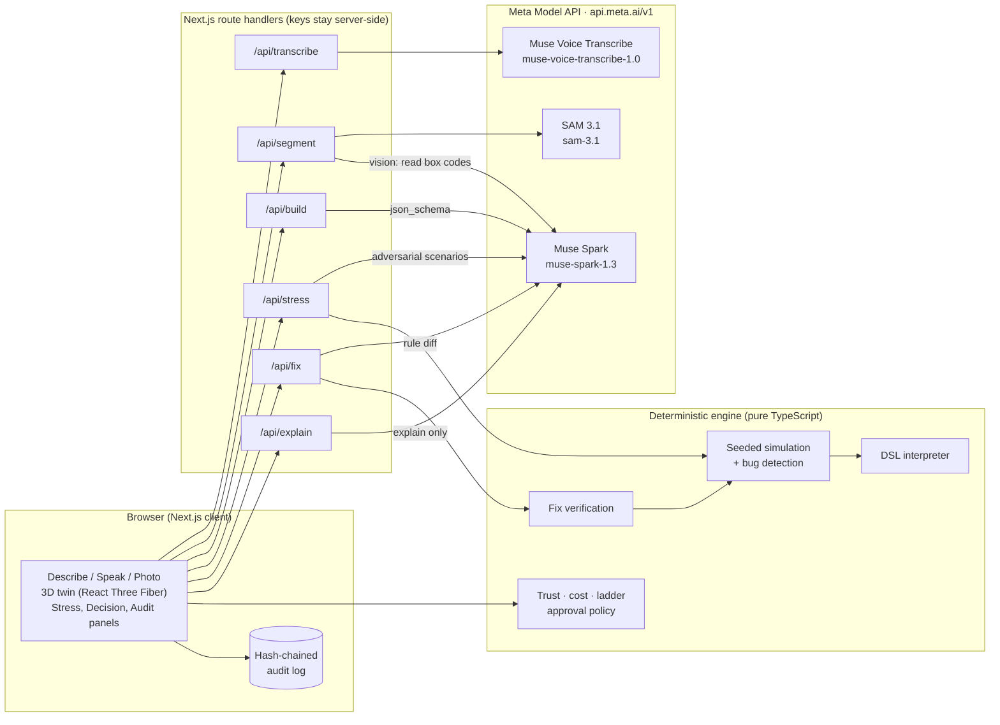

# DockTwin

**Describe a port terminal in plain English (or show a photo), get a programmable 3D digital twin, and let an agent stress-test it against conflicting real-world signals before a disruption costs you.**

Built for the Meta Global AI Developer Hackathon, track **Push the Frontier** (understanding and controlling a physical system). Every model step runs on Meta models: **Muse Spark**, **SAM 3.1**, and **Muse Voice Transcribe**.

---

## The problem

A container terminal runs on signals that disagree. The carrier's paperwork says a box is empty; the gate scale says it weighs 24 t. A reefer's sensor reads 7.5 °C; the carrier says the temperature is fine. Customs places a hold just as the box's gate lane goes down, while the free-time clock keeps running. Planners make these calls by hand, under time pressure, using rules that were never tested against these collisions. The cost shows up as demurrage, spoiled cargo, missed vessel windows, and trucks idling at dead lanes.

## The solution

DockTwin is an agent that:

1. **Builds** a twin from a description, spoken or typed, or from a yard/gate photo. Muse Spark writes a structured spec (objects plus `when → then` rules in a small JSON DSL), validated by zod. SAM 3.1 segments the photo into containers, cranes, and lanes that seed the twin.
2. **Stress-tests** it. Seeded scenarios plus adversarial scenarios invented by Muse Spark run through a deterministic simulation. The engine reports behavior bugs: rules that fight at equal priority, rules that never settle, safety expectations nobody enforces, rules that never fire, and fields nothing provides.
3. **Repairs** the rules. Muse Spark proposes each fix as a rule diff. The engine applies it to a copy and re-runs every scenario. A fix is shown as *verified*, *needs review*, or *rejected*, and nothing is applied without the planner's approval.
4. **Decides** per box, with evidence. It picks the gentlest effective action on a ladder: **watch → ask → slow → reroute → inspect → hold → hand to a human**. Each decision shows which signals were trusted and why (source trust scores), the simulation evidence, a confidence score, and an itemized cost-of-delay estimate. Low-confidence or high-impact actions require human approval. Every step lands in a SHA-256 hash-chained audit log.

**Dual use: "Ordinary Tuesday" creator mode.** The same maker and test agent build interactive objects for games and robotics, such as an automatic door or a robot gripper. The same engine finds interaction bugs, like a door that chatters when someone stands still in the safety beam.

### The core design choice: the model plans, the engine decides

| Muse Spark does | The deterministic engine does |
| --- | --- |
| Turns language and photos into a twin spec | Validates it (zod + semantic checks) and interprets the DSL. It never runs `eval`. |
| Invents adversarial scenarios | Replays them tick by tick with a seeded PRNG |
| Proposes rule fixes as diffs | Applies each diff to a copy and proves or rejects it by re-simulation |
| Explains a decision in plain English | Makes the decision: level, safety floor, confidence, cost, approval |

The same spec, scenario, and seed always give byte-identical results, so every outcome is reproducible and unit-tested.

---

## Architecture



## Meta models, and where each one is used

| Model | ID | Endpoint | Used for | Code |
| --- | --- | --- | --- | --- |
| Muse Spark | `muse-spark-1.3` | `POST /v1/chat/completions` with `response_format: json_schema` | Describe → twin spec (text, or text + photo objects) | [`api/build`](src/app/api/build/route.ts), [`lib/meta/spark.ts`](src/lib/meta/spark.ts) |
| Muse Spark | `muse-spark-1.3` | same | Stress agent: invents adversarial scenarios | [`lib/meta/agents.ts`](src/lib/meta/agents.ts) `sparkScenarios` |
| Muse Spark | `muse-spark-1.3` | same | Fix agent: proposes rule diffs | `sparkFix` |
| Muse Spark (vision) | `muse-spark-1.3` | same, with image input | Reads container codes and reefer units inside SAM's boxes | `sparkLabelBoxes` |
| Muse Spark | `muse-spark-1.3` | same | Explains an engine decision (cannot change it) | [`api/explain`](src/app/api/explain/route.ts) |
| SAM 3.1 | `sam-3.1` | `POST /v1/responses` (streamed), decoded with `@meta-sam/parser` | Photo → containers, cranes, lanes (boxes + masks) | [`lib/meta/sam.ts`](src/lib/meta/sam.ts) |
| Muse Voice Transcribe | `muse-voice-transcribe-1.0` | `POST /v1/asr/transcribe` (multipart: JSON `request` + WAV `audio`) | Spoken descriptions, biased toward terminal vocabulary | [`lib/meta/voice.ts`](src/lib/meta/voice.ts) |

Endpoints and IDs follow [dev.meta.ai/docs](https://dev.meta.ai/docs/models) and the [Meta Model cookbook](https://github.com/meta-models/meta-model-cookbook). The UI shows which Meta model handled each step, with latency, retries, and schema repairs. The audit log records the model behind every action.

**Reliability.** Retries use exponential backoff with jitter; 400s are never retried. Structured output is decoded against the JSON Schema, then zod-parsed and semantically checked. Problems go back to the model for up to two repair rounds. If a Muse Spark scenario or fix call fails, the run continues with seeded scenarios, and a clearly labeled engine-heuristic fix is offered instead.

---

## Setup

Requirements: Node.js ≥ 20.17 and a Meta Model API key from [dev.meta.ai](https://dev.meta.ai).

```bash
git clone https://github.com/nduy1234/DockTwin.git
cd DockTwin
npm install
cp .env.example .env.local   # then set MODEL_API_KEY
npm run dev                  # http://localhost:3000
```

```bash
npm test          # 58 unit + golden tests (Vitest)
npm run typecheck
npm run build
```

**Offline mock mode (local development only).** Set `MOCK_META=1` in `.env.local` to run without a key. Every mocked call is labeled `MOCK` in the UI and in the audit log. Mock mode is refused on a Vercel production deployment. The demo and the video use real Meta model calls.

**Deploy.** Import the repo in Vercel and set `MODEL_API_KEY` as an environment variable. Route handlers run on the Node.js runtime; no model key ever reaches the browser.

## Demo walkthrough (about 3 minutes)

1. **▶ Demo mode** loads *Pacific Gate Container Terminal* (fictional): 100 boxes, 4 gate lanes, 3 cranes, and one problem box, reefer **MSCU7154023** at Lane 3. It immediately runs a stress test, with Muse Spark inventing extra scenarios and proposing fixes, then replays the **Perfect storm** in 3D.
2. Scrub the timeline. Boxes light up by ladder level. Click the problem box: its state shows `gate_route=fast_lane`, the live effect of a bug.
3. **Behavior bugs:**
   - Rules R4 and R5 fight over the gate route at equal priority, so a heavy box declared "empty" gets fast-laned.
   - The reefer rule trusts the carrier's "temp OK" over the sensor, which violates the safety rule *>3 °C above setpoint ⇒ inspect*.
   Each fix arrives as a diff with **VERIFIED** (re-run across all scenarios). Approve to apply; the stress test re-runs clean.
4. **Decisions:** pick the reefer scenario at t=40.
   - The engine raised the action to *inspect* via the safety floor.
   - The sensor (trust 0.90) overrides the carrier (0.30 after contradiction).
   - Confidence is 0.72, with an itemized cost estimate.
   - The card is marked **needs human approval**.
   Approve it, override it with a reason, or hand it to a supervisor. Click **Explain (Muse Spark)**.
5. **Voice / photo:** speak a new description, or open *Photo → Twin* and segment the gate sample with SAM 3.1.
6. **Creator mode:** switch tabs and build the automatic door. The stress test finds the chattering door (R2/R3 never settle when someone stands still in the beam) and the unhandled power loss, then verifies the fixes. Same engine, different template.
7. **Audit log:** every step, with the Meta model that acted, hash-chained and exportable.

See [DEMO.md](DEMO.md) for the timed video script.

## Repository map

```
src/engine/      deterministic core: schema + DSL, interpreter, sim, scenarios,
                 fix verification, trust, cost, decision ladder, audit, layout, demo
src/lib/meta/    Meta Model API clients (Spark, SAM, Voice), retries, agents, mock mode
src/templates/   domain templates: port terminal, creator mode
src/app/api/     route handlers: build, transcribe, segment, stress, fix, explain
src/components/  3D twin, inspector, stress, decision, photo, audit panels
tests/           Vitest unit tests + golden test (tests/golden/demo.json)
public/samples/  public-domain / CC0 sample photos (see LICENSES.md)
```

## Built during the hackathon (Oct 27 – Nov 4, 2026)

Everything in this repository was written during the building period. The only earlier commit (`63306d1`, Oct 26) is GitHub's generated repository scaffold: an MIT `LICENSE`, a one-line `README.md`, and a template `.gitignore`. It contains no code.

| Date | Commit | What was built |
| --- | --- | --- |
| Oct 29 | `c39db99` | Next.js app; zod twin schema + rule DSL that doubles as the Muse Spark JSON Schema; Meta client with retries, schema repair, model-call log, mock mode; Describe → Build |
| Oct 29 | `8f78648` | Deterministic DSL interpreter; seeded simulation with conflict / oscillation / invariant / dead-rule / unknown-fact detection; 3D layout and clickable twin |
| Oct 29 | `ec1e939` | Scenario generator and threshold fuzzer; Muse Spark scenario and fix agents; fix verification by re-simulation; stress panel with replay |
| Oct 29 | `bc1d9f2` | Source trust and contradiction resolution; cost-of-delay model; decision ladder with safety floor, confidence, approval policy; hash-chained audit log; Muse Spark explanations |
| Oct 29 | `b36fa81` | Muse Voice Transcribe (browser WAV capture); SAM 3.1 photo segmentation + Muse Spark vision labels → twin objects; bundled sample photos |
| Oct 29 | `528c79d` | "Ordinary Tuesday" creator mode: creator template, generic interaction stress, door/gripper meshes |
| Oct 29 | *this commit* | Demo mode (seeded 100-box terminal), animated replay, golden test, README, DEMO.md |

Third-party code is used only as npm dependencies (Next.js, React, three.js / React Three Fiber / drei, zod, the OpenAI SDK pointed at the Meta Model API, `@meta-sam/parser`, Tailwind, Vitest). Sample photos are public domain or CC0; see [`public/samples/LICENSES.md`](public/samples/LICENSES.md).

## License

[MIT](LICENSE)
